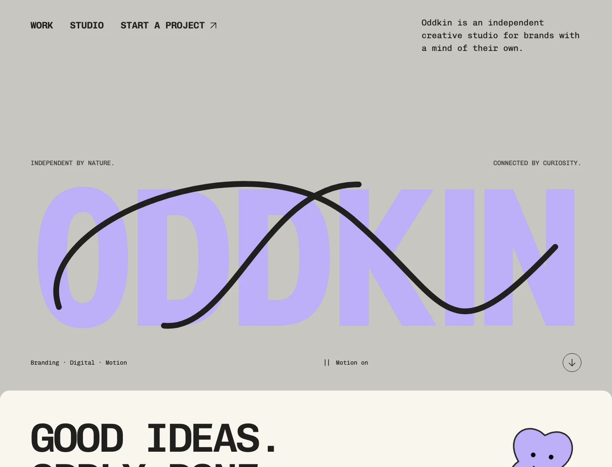
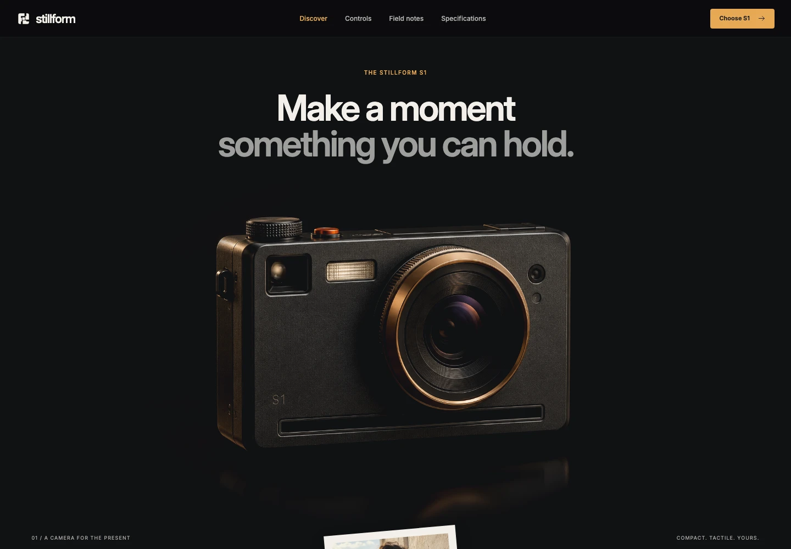
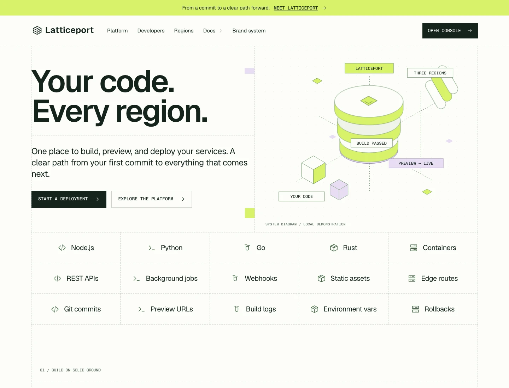

# Four distinct directions for a React website

A visual field guide from **LOOKFILE**, the creator and seller of these kits. Start with the audience and the interaction you want someone to try. All four brands below are fictional frontend demonstrations.

| Starting point | Kit | Design decision |
|---|---|---|
| Independent studio | Oddkin Studio | Lead with personality, then make the project brief easy. |
| Lifestyle product brand | Velora Scent | Use one strong product image to set the pace. |
| Product launch | Stillform Camera | Let visitors try one small interaction before reading every specification. |
| Developer-facing SaaS | Latticeport | Show the workflow as well as the promise. |

## Oddkin Studio — independent studio

Lead with personality, then make the project brief easy. Compare the oversized wordmark with the quieter navigation. Try the service selector and project-brief builder. A useful customization is replacing one fictional case study before changing the whole visual system.

[Explore Oddkin Studio and open its live preview](https://lookfileai.com/product/oddkin-studio?utm_source=community&utm_medium=campaign&utm_campaign=lf-github-oddkin-studio-261022)

## Velora Scent — lifestyle product brand

Use one strong product image to set the pace. Explore the scent finder, fragrance notes and sample tray. When adapting this pattern, label product imagery and sample-only actions clearly; connect real inventory and checkout separately.

[Explore Velora Scent and open its live preview](https://lookfileai.com/product/velora-scent?utm_source=community&utm_medium=campaign&utm_campaign=lf-github-velora-scent-261022)

## Stillform Camera — product launch

Let visitors try one small interaction before reading every specification. Try the six mode tabs and the aperture/viewfinder previews. The camera and its prices are fictional. When adapting it, replace demonstration claims with your own verified product facts.

[Explore Stillform Camera and open its live preview](https://lookfileai.com/product/stillform-camera?utm_source=community&utm_medium=campaign&utm_campaign=lf-github-stillform-camera-261022)

## Latticeport — developer-facing saas

Show the workflow as well as the promise. Compare the ruled grid, isometric topology and local deployment console. The demo does not deploy anything. Keep a future real API integration separate from local UI feedback.

[Explore Latticeport and open its live preview](https://lookfileai.com/product/latticeport?utm_source=community&utm_medium=campaign&utm_campaign=lf-github-latticeport-261022)

## Try a complete interaction

[Make the failure state part of your product demo](latticeport-failure-recovery.md) — follow a real failure-to-recovery sequence in the Latticeport preview, with two captured states and a practical design-review checklist.

[Make a product finder lead somewhere useful](velora-scent-finder.md) — inspect Velora Scent’s three-question recommendation, fragrance-note tabs and local sample tray, with captured states and a reusable design-review table.

[Carry the record into the request](cinderline-record-to-request.md) — follow a searchable fictional architecture archive from a record to a local request, including an empty-search recovery state and actual captures.

## A practical first-edit exercise

1. Choose one audience and one next action before touching the layout.
2. Replace the hero title with a specific, truthful promise. Preserve the section hierarchy and mobile layout.
3. Replace one sample asset and its alt text. Keep the source license and rights record.
4. Change one interaction at a time. Test keyboard focus, cancellation, empty input and a narrow viewport.
5. Clearly separate demo feedback from real enquiries, payments, bookings or deployments. Connect those services only after their behavior is implemented and verified.

Example instruction for your editor:

> Adapt the hero copy to [audience] and [verified benefit]. Keep the existing layout and responsive behavior. Do not invent customers, testimonials, performance results or connected services. Show the exact changes and explain how to verify them.

## Scope and rights

This repository is a promotional visual guide, not the commercial kit source. The previews and screenshots are LOOKFILE concept work; generated imagery is not evidence of real products or customers. Each product page identifies the current release and license. Commercial source downloads are available separately under their listed terms. No hosting, integrations, support response SLA or future update promise is made here. AI editing outcomes have not been benchmarked across editors or models.

