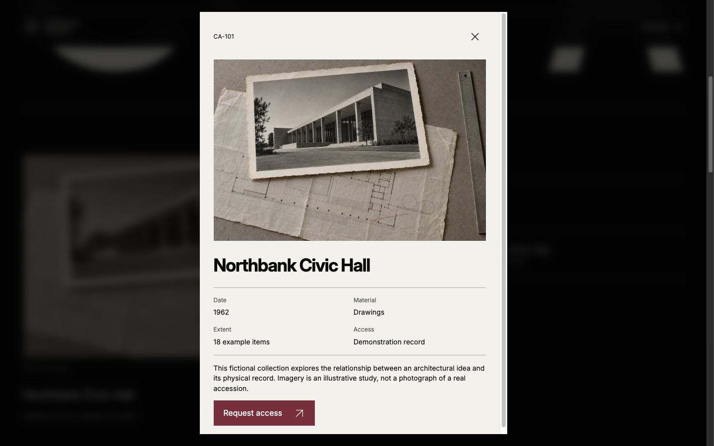
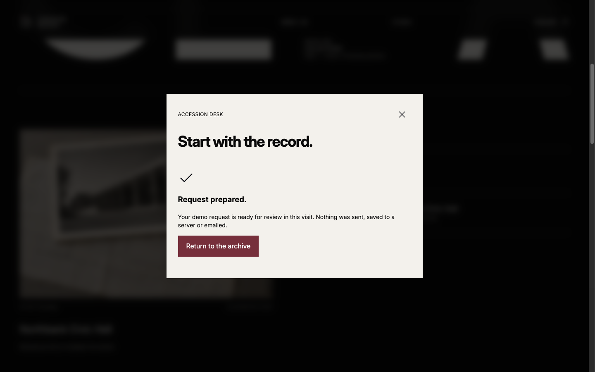
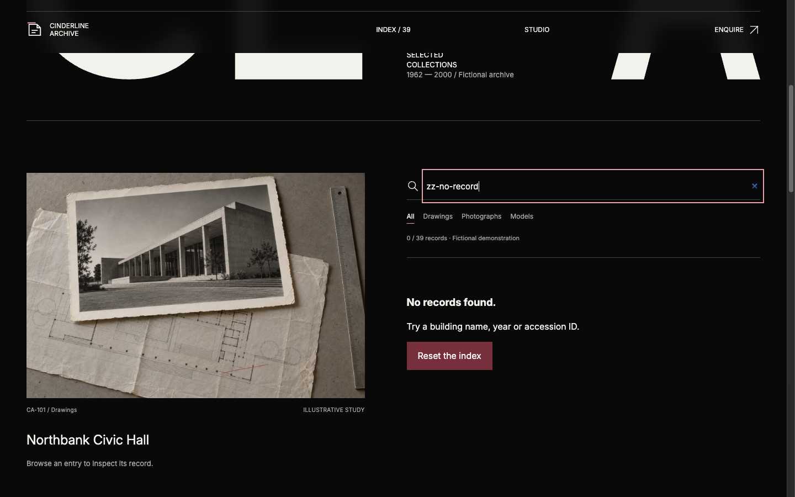

# Carry the record into the request

A practical archive-interface walkthrough by **LOOKFILE, the creator and seller of Cinderline Archive**. This is our studio demonstration of release **1.0.0**, observed on 25 October 2026. All collections are fictional and the archival images are generated illustrative studies, not photographs of real accessions.

A striking archive homepage still needs to help someone find a record and explain what happens next. Cinderline uses oversized monochrome type for the opening, then switches to a compact, ruled accession index. The useful part is the handoff from that index to the request.

## Try the sequence

Open the [live browser demonstration](https://preview.lookfileai.com/kits/cinderline-archive/1.0.0/).

1. Search for `Northbank`. The index changes from 39 records to one result.
2. Open **Northbank Civic Hall — CA-101**. The detail separates date, material, extent and access status. It identifies the entry as a demonstration record.
3. Select **Request access**. The request type is already **Access a record**, and the material field contains the selected title and accession ID. You do not have to remember or retype the identifier.
4. Use invented details such as `Studio demo` and `demo@example.com`, then choose **Prepare demo request**. The confirmation explicitly says nothing was sent, saved to a server or emailed.

## Inspect the dead end, too

Search for `zz-no-record`. The observed result is **0 / 39 records**, a **No records found** message, a suggestion to try a building name, year or accession ID, and a **Reset the index** action. An empty result has a way back into the collection.

## Review the handoff before adapting it

| State | What to preserve | What a real service would need |
| --- | --- | --- |
| Search | Result count and a visible recovery action | A defined search source and loading/error states |
| Record | Stable accession ID beside human-readable context | Verified metadata, rights and access restrictions |
| Request | Selected record carried into the form | Server validation, permissions and a stated purpose for collected data |
| Confirmation | Wording that matches what actually happened | Delivery evidence before saying a request was sent |

A useful first edit is to replace one fictional record with material you have permission to use. Keep its identifier, detail view and request prefill consistent. Then review keyboard navigation, focus return, narrow screens and failure behavior before connecting a backend. These are suggested checks, not claims that this walkthrough certifies every accessibility or production requirement.

The browser demonstration is free to inspect. The **USD 27 source kit** is a separate React/TypeScript frontend product; it is not a hosted archival service. No backend integration, hosting or real archival access is included. Prices and release terms are shown on the current product page.

[Inspect Cinderline Archive and its source-kit details](https://lookfileai.com/product/cinderline-archive?utm_source=community&utm_medium=campaign&utm_campaign=lf-github-archive-flow-cinderline-archive-26102506)

Screenshots above are actual captures of the published preview. This guide distributes explanatory text and concept screenshots only, not the commercial kit source. No customer results, time savings or conversion improvements are claimed.
