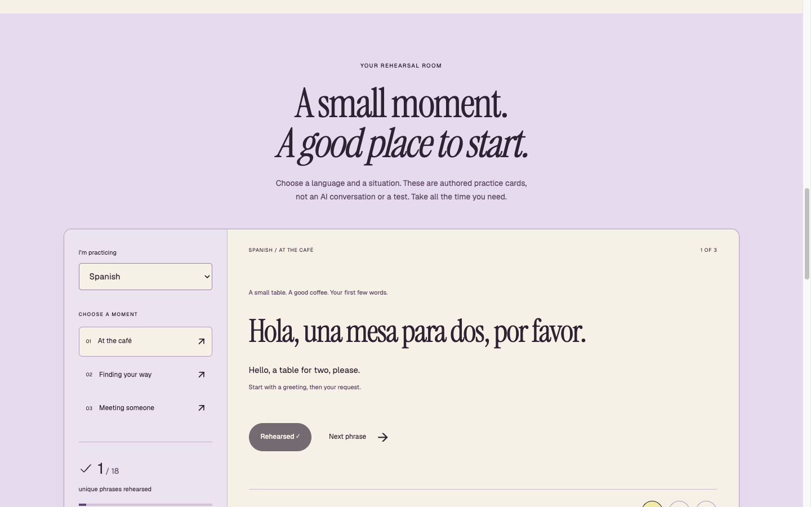
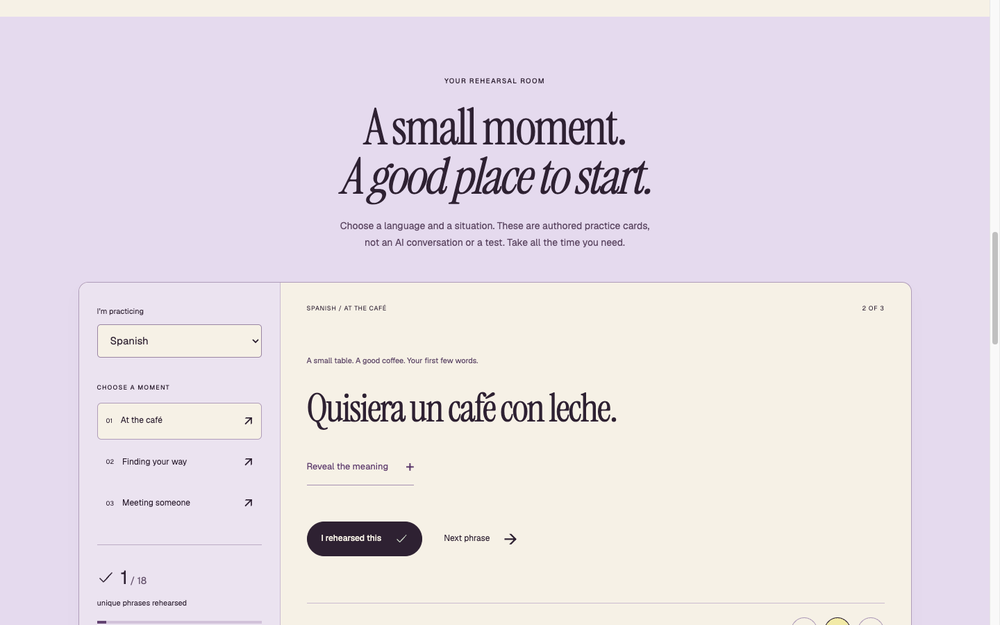

# Count practice, not button presses

A small interface exercise for people building educational frontends.

This is an original studio walkthrough by **LOOKFILE, the creator and seller of Formant Practice**. The fictional service contains authored French and Spanish cards. It is not an AI tutor, a language course, or a voice assessment. The observations below come from the public **1.0.0** preview on 25 October 2026.

## Try the state transition

1. Open the [free browser demonstration](https://preview.lookfileai.com/kits/formant-practice/1.0.0/) and enter the rehearsal room.
2. Choose **Spanish** and **At the café**. The first card reads “Hola, una mesa para dos, por favor.”
3. Select **Reveal the meaning**. The translation and a short usage cue appear. Revealing a card does not itself mark it as practiced.
4. Select **I rehearsed this**. The counter becomes **1 / 18 unique phrases rehearsed**, and the card button becomes disabled **Rehearsed ✓**.
5. Select **Next phrase**. The next card begins with its meaning hidden while the counter stays at **1 / 18**. Navigation is not completion.

## What to carry into your own teaching interface

| Moment | Question to ask |
| --- | --- |
| Before the reveal | Can learners attempt the prompt before seeing the answer? |
| After self-reporting practice | Does the label describe what actually happened, without claiming mastery? |
| Returning to the same item | Can one item accidentally inflate a progress total? |
| Moving to another item | Does navigation keep completion separate? |
| Leaving the page | Is the persistence boundary visible beside the progress? |

In this preview, the status explicitly says progress lasts for the page session. The UI also states that it does not record or score a voice. Those boundaries are part of the lesson: a local self-report should not look like an assessment result or a saved account record.

## A bounded first-edit exercise

Keep the cream background, dark plum type, lavender accents, card hierarchy and generous spacing. Replace one three-card scenario with terminology for a workshop you actually teach. For each card, write a prompt, a reveal and a small usage cue. Then revisit a completed card, change scenarios, and refresh the page. Decide whether the displayed persistence promise still matches the behavior before adding a backend.

This is a proposed adaptation exercise, not a claim that an AI editor performed it or that learners improved. No learner outcomes were measured.

## Inspect the kit

[View Formant Practice, its current release and live preview](https://lookfileai.com/product/formant-practice?utm_source=community&utm_medium=campaign&utm_campaign=lf-github-practice-state-formant-practice-26102518).

The browser demonstration is free to inspect. The React/TypeScript frontend source was listed at **USD 27** when checked. Backend services, hosting, voice recording, AI access and future updates are not included. Check the current product page and release terms before buying. This guide shares promotional screenshots and original commentary, not the commercial source package.
