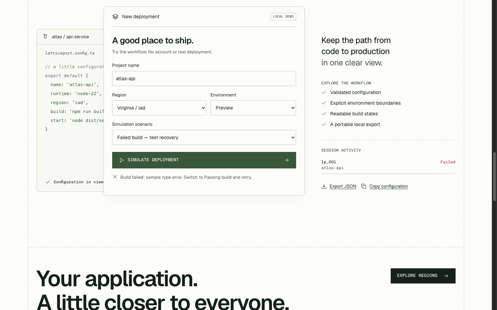
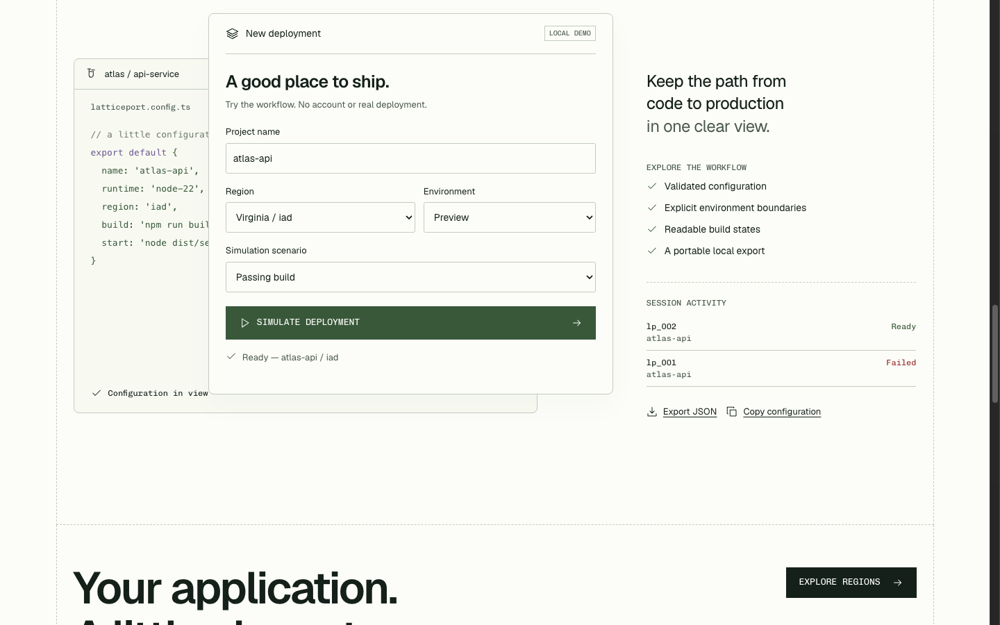

# Make the failure state part of your product demo

A hands-on design walkthrough by **LOOKFILE**, the creator and seller of Latticeport. This is our own fictional frontend demonstration, not a customer case study or a running infrastructure service. You can follow the exercise in a browser without buying or downloading the kit.

A polished landing page can show the happy path and leave the recovery path unexplained. This exercise asks a more concrete question: **when a demo fails, can a visitor see what happened and what to do next?**

## Try the same sequence

[Open the Latticeport 1.0.0 live demo](https://preview.lookfileai.com/kits/latticeport/1.0.0/), then choose **Open console**. The panel is labeled **Local demo** and says that it creates no account or real deployment.

1. Keep the project name `atlas-api`, region **Virginia / iad**, and environment **Preview**. These are sample inputs, not infrastructure credentials.
2. Change **Simulation scenario** to **Failed build — test recovery**.
3. Select **Simulate deployment** once. While the simulation runs, notice the progress message and disabled form controls.
4. At the end, read the message below the action. It identifies a sample type error and tells you to switch to **Passing build** and retry. The activity area also records the failed run.
5. Change only the scenario to **Passing build** and select **Simulate deployment** again.
6. Compare the result: the status becomes **Ready — atlas-api / iad**, the prior inputs remain, and the activity area retains both the failed run and the new ready run.

These are the actual states we observed on October 22, 2026, in the published 1.0.0 browser preview. The screenshots below show one continuous local session. They are not production logs or customer activity.

### Failure: explanation beside the action

The error appears close to the button that triggered it. The explanation includes an action the visitor can actually take. The activity row keeps the failed attempt visible instead of silently replacing it with a success screen.

### Recovery: a new result with the earlier attempt preserved

The user changes one control to explore the alternate path. The layout stays recognizable: project configuration in the center, session activity on the right, and status immediately below the primary action.

## What to take into your own design review

| Review question | What this demo lets you inspect |
| --- | --- |
| Is the boundary clear before someone acts? | Local-demo labels appear with the console, and the footer identifies a fictional service. |
| Is a result described in words? | Progress, failure and readiness have visible text; the status is not communicated by color alone. |
| Does the error suggest a real next action? | The message names the scenario to change before trying again. |
| Can someone keep their context? | Project, region and environment remain populated through this sequence. |
| Can someone tell attempts apart? | The activity area retains the failure and the following ready state. |

Use these as review questions, not a conversion claim. We have not measured whether this pattern increases sales, reduces support requests, or improves task completion. The screenshots also do not establish a complete accessibility audit. Test keyboard access, focus, announcements, small screens and reduced motion in your own implementation.

## An honest demo is a scoped promise

This simulator does not build code, create a cloud account, validate credentials, connect a backend, or deploy a service. Its example API hostname uses `.example`; the displayed latency values are explicitly illustrative. A real product would need its own backend, authorization, error handling and service guarantees.

The useful design lesson is available in the free preview: show the boundary, let people explore a recoverable failure, and keep enough context to understand the next step.

[Inspect the Latticeport kit, included files and current license](https://lookfileai.com/product/latticeport?utm_source=community&utm_medium=campaign&utm_campaign=lf-github-local-demo-latticeport-26102206). The commercial source kit is separate from this public walkthrough. Hosting, integrations, future updates and measured AI-editor outcomes are not promised here.

**Evidence:** published release 1.0.0; LOOKFILE studio capture on October 22, 2026; default `atlas-api` / `iad` / `preview` inputs; failure scenario followed by passing scenario. Screenshots are LOOKFILE promotional material. No customer data or paid source archive is included.
