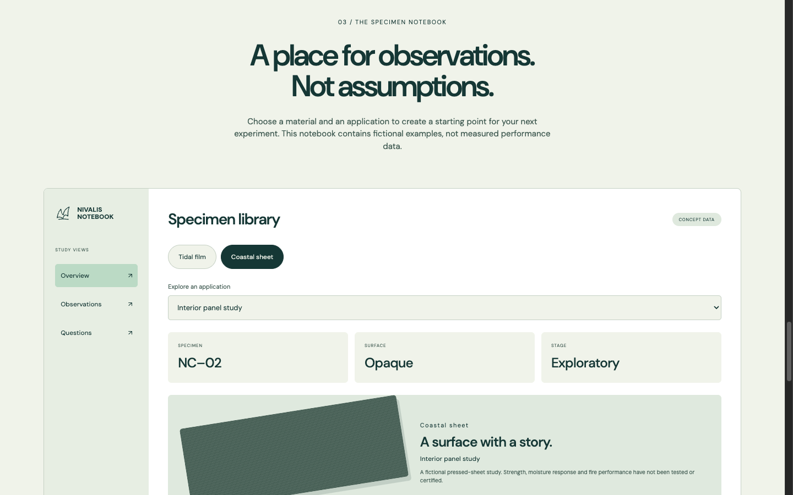
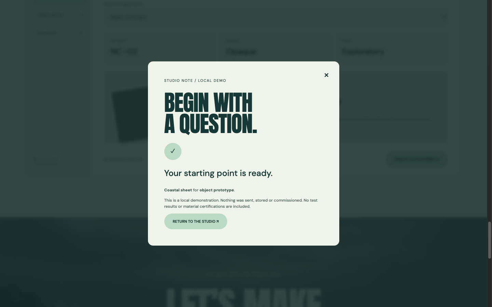

# Carry a material choice into the brief, without inventing evidence

A hands-on frontend walkthrough from **LOOKFILE, the creator and seller of Nivalis Coast**. This is our fictional materials-studio concept, release 1.0.0, inspected on 26 October 2026. It is not a real laboratory or a report of tested material performance. The screenshots show the actual browser demo; its marine and material imagery is generated concept imagery.

## Try the dependent choices

Open the free browser preview from the product link below and scroll to **The specimen notebook**.

1. Start with **Tidal film**. Its application menu contains Packaging study, Light installation and Surface experiment.
2. Select **Coastal sheet**. The menu changes to Interior panel study, Object prototype and Surface experiment. The description changes with the material, too: the sheet has no tested or certified strength, moisture response or fire performance.
3. Choose **Object prototype**, then **Create a study brief**. The brief opens with Coastal sheet and Object prototype already selected.
4. Enter a question, for example: “What would need testing before this could be used for an object prototype?” Choose **Create local brief**.

The useful detail is the relationship between the two choices. An application that made sense for one material should not silently remain selected after the material changes. In an adaptation, keep the set of allowed applications beside the material definition, and validate the pair when producing the brief.

## Make the result describe what happened

The final screen shows the selected pair and explains that nothing was sent, stored or commissioned. That boundary matters for a research-facing design: selecting an attractive concept does not create evidence that it is safe, certified, available or suitable for manufacturing.

This is a local demonstration. It does not create a laboratory commission, test result or enquiry. Reloading clears the temporary page state. The confirmation does not display the written question in its summary; if you adapt this into a real brief workflow, decide explicitly how the question should be reviewed and persisted before adding transmission.

## A bounded first-edit exercise

For a fictional textile workshop, change the visible material names and application labels together. Keep the hierarchy, large typography, marine-green palette and disclosure placement while testing these cases:

| Action | Check |
| --- | --- |
| Change the material after choosing an application | The new application is valid for that material. |
| Open the brief from the notebook | Both choices match the notebook state. |
| Change a choice inside the brief | The displayed outcome uses the final selection. |
| Finish the local demo | The copy describes the local result and makes no delivery or certification promise. |
| Reload | Temporary state is not described as a saved project. |

This is a suggested editing exercise, not a claim that we measured AI editing performance or completed a production integration. Before connecting a real service, add the required storage, validation and failure handling, and use substantiated material claims.

## Inspect the actual kit

[Open Nivalis Coast and its free live preview](https://lookfileai.com/product/nivalis-coast?utm_source=community&utm_medium=campaign&utm_campaign=lf-github-material-brief-nivalis-coast-26102618)

The browser preview is free. The React/TypeScript source kit is listed separately at **USD 27** at the time of inspection. It includes the packaged frontend and documentation under the release-specific commercial license; it is not a hosted research service. This guide does not redistribute the paid source. No customer results, new visitors or performance improvements are claimed.

Written with AI assistance from a directly inspected LOOKFILE studio demonstration.
