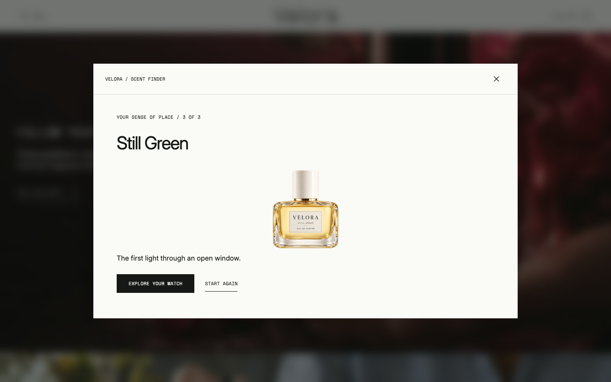
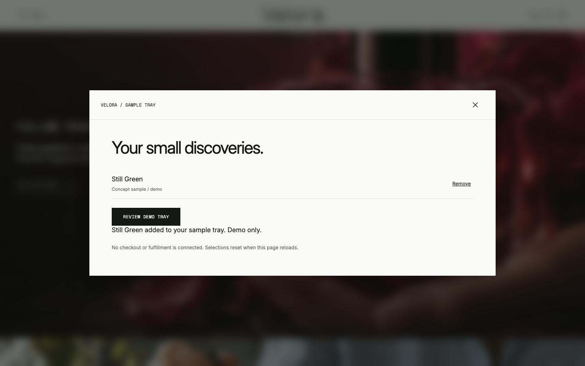

# Make a product finder lead somewhere useful

A warm product photograph can set a mood. The next useful question is what a visitor can actually do. This walkthrough is for designers adapting a lifestyle or fragrance storefront: follow one choice all the way from a short finder to a reversible sample selection.

This is a studio demonstration by **LOOKFILE**, creator and seller of Velora Scent. We inspected the published **1.0.0** preview on **22 October 2026**. Velora is fictional. Its generated imagery, fragrance notes and recommendations are concept content, not claims about real perfume or a personal assessment. No order, payment or physical sample is created.

## Follow one complete path

[Open the kit details and launch the live preview](https://lookfileai.com/product/velora-scent?utm_source=community&utm_medium=campaign&utm_campaign=lf-github-scent-finder-velora-scent-26102218).

1. Open **Find your scent**. The dialog shows the first of three questions.
2. Choose **A garden before sunrise**, then **Fresh green leaves**, then **Quietly energizing**.
3. The result in this inspected path is **Still Green**, with the line “The first light through an open window.” The result offers both **Explore your match** and **Start again**.
4. Choose **Explore your match**. The fragrance-notes dialog opens with **Opening** selected and **Bergamot peel** shown. Choose **Drydown** to see **Soft cedar**.
5. Choose **Add to sample tray**. The interface confirms the named item and says **Demo only**. Close the dialog and open **Tray (1)** to inspect the selection.

The recommendation gives the visitor a named result and a specific next step. The fragrance tabs then expose more detail without making the visitor start the finder again.

## Use a state table before changing the visuals

| State | What the visitor needs to understand | What to inspect in your adaptation |
|---|---|---|
| First question | How much effort this takes | Keep the step count visible and each answer understandable on its own. |
| Later question | How to correct a choice | Test the Back control and verify that its behavior matches your intended selection model. |
| Result | What was selected and why it is useful | Keep a clear product name, an honest explanation and an option to start again. |
| Product detail | What the next action will do | Make note tabs understandable and label demo actions before the click. |
| Added selection | Which item changed | Give text feedback that names the item, then keep the tray easy to find. |
| Tray | What is selected and what happens next | Check removal and empty state; distinguish a local selection from a real order. |

This table is a review aid, not a claim that every keyboard, screen-reader, mobile or alternative-answer path has been tested here. The two screenshots show the exact desktop path above. They do not establish usability, conversion improvements or personalized recommendation accuracy.

## A focused first edit

Replace the three question prompts and their answer labels for your own product range. Keep the dialog structure, progress indicator and typography while you make that change. Write down the expected result for every answer combination before connecting a recommendation service.

A practical brief for your coding assistant:

> Adapt the finder questions to [audience] using only [verified product facts]. Keep the existing layout and visual hierarchy. Preserve Back, close and restart controls. Show the recommendation rule and the empty/error behavior. Keep all selection actions labeled as a demo until the real service exists. Do not invent scientific matching, stock availability, customer results or checkout success.

After editing, try a longer answer, a narrow viewport, keyboard-only navigation, closing and reopening the dialog, starting again and removing the last tray item. Record what passed and what still needs work. A real store additionally needs verified inventory, consent/data handling, pricing and an order service; this frontend does not provide those connections.

## Scope and rights

This walkthrough and its screenshots document LOOKFILE's concept work. The commercial kit source is not included in this repository. The product page identifies the current release and license. No hosting, integration, future update or AI-editing performance guarantee is made.
