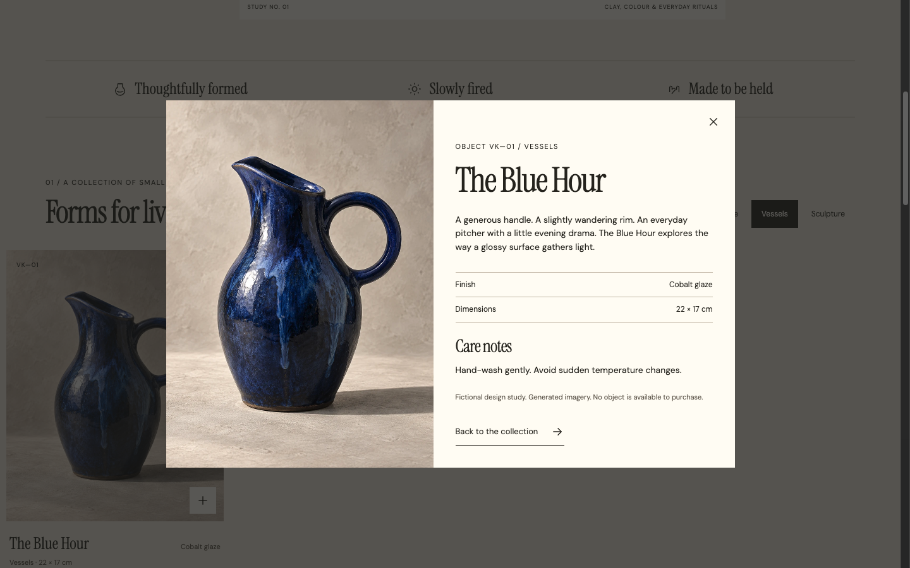
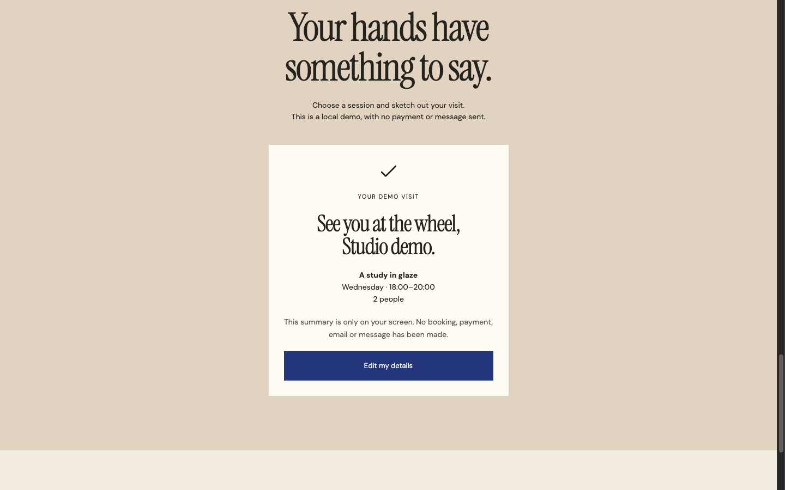

# Let visitors inspect the object before asking them to book

A studio demonstration from **LOOKFILE, the creator and seller of Vesper Kiln**. This is a fictional ceramics studio, with generated object imagery and a local workshop planner. No ceramics, appointments or customer results are being advertised.

A craft-studio page has two different jobs: help someone look closely at the work, and help them understand a visit. Vesper Kiln 1.0.0 separates those jobs while keeping its cream surfaces, narrow serif headings and cobalt accents consistent.

## Try the object path

1. [Open Vesper Kiln and its live preview](https://lookfileai.com/product/vesper-kiln?utm_source=community&utm_medium=campaign&utm_campaign=lf-github-craft-workshop-vesper-kiln-26102606). The preview is free; the React/TypeScript source kit is sold separately (USD 27 at review on 26 October 2026).
2. Choose **Vessels** in the collection. Four objects become one matching object.
3. Open **The Blue Hour**. The detail layer puts the generated photograph beside finish, dimensions and care notes. It also states that no object is available to purchase.
4. Close the details. You return to the filtered collection, rather than starting the browsing task over.

## Try the visit path

Select **A study in glaze** and **2 people**, enter a demonstration name, then choose **Prepare my visit**. The result repeats the session and party size and explains that no booking, payment, email or message was made. **Edit my details** lets the visitor revise the plan.

## Use this as a review exercise

| Visitor question | What to inspect | What to change for a real studio |
| --- | --- | --- |
| Is this the kind of work I want? | Category labels and the visible result count | Use your real categories; keep the all-items recovery path. |
| Can I see enough before deciding? | Image, finish, dimensions and care in one detail layer | Replace generated images and sample object facts with owned, verified material. |
| What will I attend? | Session, time and party size repeated in the summary | Connect actual availability and server confirmation before calling it a reservation. |
| Can I correct a mistake? | Close details and edit the visit | Preserve selection and focus; test keyboard navigation and a narrow viewport. |

A bounded first edit: replace one object photograph and its alt text, then update its finish and dimensions. Keep the surrounding hierarchy and spacing. Next, review the detail layer and collection together so the card and expanded view still describe the same object.

The screenshots above were captured from the published 1.0.0 preview during this walkthrough. They are design evidence, not proof of conversion, attendance or an accessibility audit. The real kit includes frontend source and documentation; hosting, backend integration and future updates are outside the included support scope.

[Inspect the kit, current terms and working preview](https://lookfileai.com/product/vesper-kiln?utm_source=community&utm_medium=campaign&utm_campaign=lf-github-craft-workshop-vesper-kiln-26102606)
